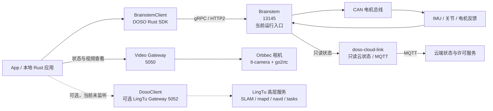
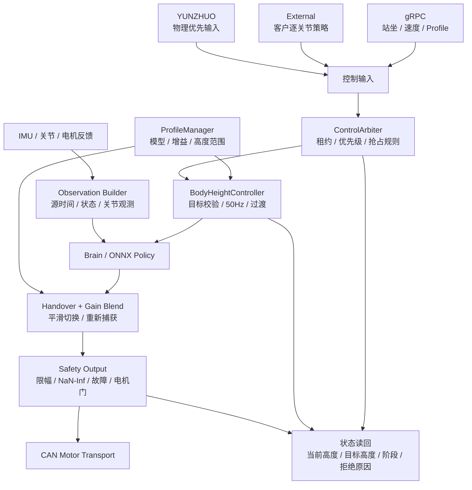
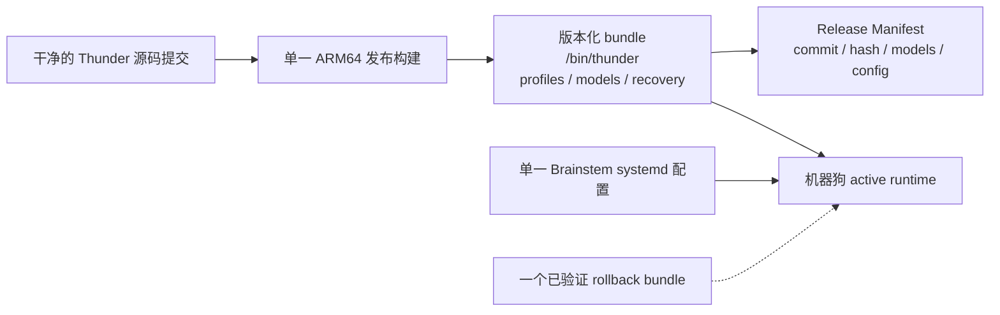
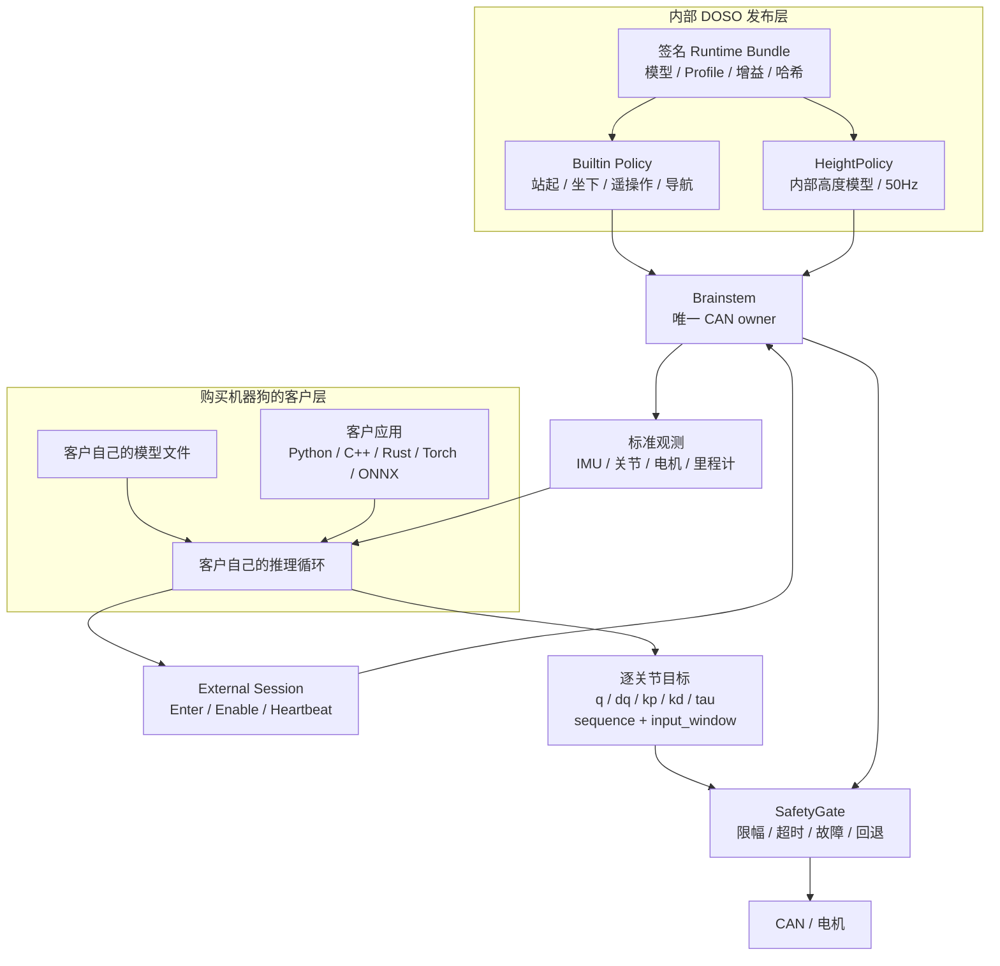

# DOSO SDK 与 Brainstem 架构讨论图

这张图按 2026-11-20 真机审计结果绘制。实线表示当前已经存在的运行链，虚线表示需要纳入下一版发布的能力。

## 当前运行链



当前真机监听状态如下。

| 入口 | 当前状态 | 责任 |
|---|---|---|
| `13145` | 运行中（`v0.0.1` 源码已合入 `Damp` 与 `RobotExternalControl`） | Brainstem 原生状态、观测、内置运动与 Layer-2 客户 External 统一入口 |
| `5050` | 运行中 | 相机状态、JPEG、WebRTC 视频入口 |
| `5052` | 未监听 | LingTu 七域高层 Gateway，尚未作为当前真机入口 |
| `13146` | Step 1.3 已挂载 | `LocalStatusService` 本机回环只读 `GetControlStatus` 入口 |
| `doso-cloud-link` | 运行中 | 只读云状态和许可同步 |

## 目标 Brainstem 运控链

高度控制应该进入当前 Brainstem 的单一控制链。它不能以第二个服务、第二个 CAN owner 或独立 `han_dog` 进程运行。



高度控制的单一 owner 是 Brainstem。策略需要遵守以下边界。

- YUNZHUO 的优先级由现有仲裁器决定，普通 gRPC 和 External 不能绕过仲裁器直接写 CAN。
- 高度策略使用 50 Hz 控制周期，输入目标必须经过 Profile 的有效范围校验。
- Profile、模型和模型哈希必须随同一个发布 bundle 管理。
- 电机禁用、控制权丢失、Profile 切换、CMS 状态转换、模型错误和电机故障都要取消或挂起高度过渡。
- RPC 回执只代表请求被接纳。实际高度和过渡完成必须通过状态流读回。

建议的 Brainstem 公共状态字段如下。

```text
active_height
target_height
height_profile
handover_phase
policy_status
model_id
model_sha256
reject_reason
```

## 目标发布边界



当前机器狗需要从多个历史目录收敛到这个发布边界。现有 active binary 是 `thunder_w5_stairs_gesture_rpc_20261119_31af705`，日志仍加载 `thunder_w5_stairs_motion_slots_20261117_0e0115b` 的 Profile。清理必须先固定这组依赖，再生成一个 canonical systemd override，最后才归档旧 deployment 和 drop-in。

## 两层策略模型

内部策略和购买机器狗客户的策略属于两个生命周期。内部策略随 DOSO 发布 bundle 交付，客户策略由客户自己的程序加载和推理。



当前 Rust SDK（`BrainstemExternalClient`）、C++ SDK（`brainstem::ExternalControl`）与 Brainstem `v0.0.1` 服务端（`ExternalService` + `ExternalRuntime` + `HardwareExternal` + `RealJoint` 5 项 MIT `SafetyGate`）均已实现并完成本地单测闭环（待随 `v0.0.1` 发布包部署并验收真机）。原生 External frame 是 16 个关节目标，包含 `q`、`dq`、`kp`、`kd`、`tau`、递增 `sequence` 和 Brainstem 签发的 100 ms `input_window`。SDK 不要求客户使用某一种策略语言或推理框架。[External 协议](../brainstem/protocol/brainstem_api/external.proto) · [Rust 实现](../src/brainstem/mod.rs) · [Brainstem HardwareExternal](../../brainstem/thunder/lib/src/external/hardware_external.dart)

External 会话的客户流程如下。

```text
客户程序加载自己的模型
        ↓
BrainstemClient 连接 13145
        ↓
读取能力、关节布局和标准观测
        ↓
Enter → Enable
        ↓
读取 IMU / 关节 / 电机状态
        ↓
客户模型推理
        ↓
50Hz 逐关节目标 + sequence + input_window
        ↓
Brainstem 验证、限幅和安全输出
        ↓
Disable → Exit → 回到约定的内置安全状态
```

External 模式和 HeightPolicy 需要互斥。External 逐关节模式由客户负责高度和关节目标，内部 HeightPolicy 不能同时写入同一组关节。后续可以增加独立的 External Intent 模式，让客户提交速度和目标高度，由 Brainstem 内部 HeightPolicy 生成关节目标，这属于另一个能力合同。

Unitree 的公开 `unitree_rl_gym` 示例采用客户进程加载 TorchScript 策略、订阅 LowState、计算关节目标并发布 LowCmd。Go2 SportClient 还提供站起、坐下、恢复、速度和部分高度等高层动作。公开资料没有显示一个完整的客户模型仓库或模型生命周期服务。DOSO 可以保留这种客户自带模型的自由度，同时让 Brainstem 保持唯一 CAN owner。[Unitree deploy_real.py](https://github.com/unitreerobotics/unitree_rl_gym/blob/main/deploy/deploy_real/deploy_real.py) · [Unitree SportClient](https://github.com/unitreerobotics/unitree_sdk2/blob/main/include/unitree/robot/go2/sport/sport_client.hpp)

## 讨论时需要先定的三个决策

1. BodyHeight 的正式输入是否统一为 `target_height` 加当前速度输入 `[vx, vy, wz]`。
2. 高度策略的状态读回是否直接加入 `RobotControl`，还是随 `ListenCmsState` 扩展。
3. 第一版发布是否只支持当前 Thunder 型号和当前已验证模型，其他型号通过能力查询拒绝。

相关清理证据见 [CLEANUP_PLAN.md](../../DOSO/artifacts/robot-cloud/fs-audit-20261120/CLEANUP_PLAN.md)，高度策略分析见 [bodyheight-architecture-20261120.md](../../DOSO/artifacts/robot-cloud/bodyheight-architecture-20261120.md)。
