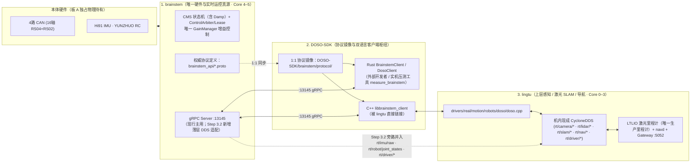

# DOSO 整机收敛与演进路线（三端对齐 + 渐进旁路）

日期：2026-11-20  
定位：承接 [当前整机架构](architecture.md) 与 [功能清单与验收状态](features.md)。本文件针对实机与代码排查暴露出的核心痛点——**`brainstem`（31af705）、`DOSO-SDK`、`lingtu` 三端代码脱节、内部控制路径分叉、半成品悬空**——确立**先做减法、逐项收口、一步一验证**的收敛路线，再稳步演进至双板解耦与全栈 CycloneDDS。

---

## 一、 收敛原则：先做减法，绝不铺新摊子

1. **只保留并打磨当前真正需要交付的主干能力**：
   - 底层运控：`Enable/Disable`（含自检互锁）、`StandUp/SitDown`、`WalkChecked(vx, vy, wz)`、`Damp`（解析式阻尼软急停）、`flat/stairs` 预热槽位切换、`PlayGesture`、真实可靠的 100Hz IMU（`rad/s` + `m/s²` + quaternion + 单调时间戳）/ 16 轴关节反馈 / 电机电压查询。
   - 上层定位与导航：`LingTu` 的激光惯性里程计 `LTLIO` 与 `navd` 导航闭环（`LingTu` 内部本已跑在原生 `rt/*` CycloneDDS 上，保留不动）。
2. **近期暂缓项（移至附录，在三端完全收敛前一行新算法代码都不写）**：
   - **暂缓轮腿运动学里程计（Leg-Wheel EKF）**：当前 `brainstem` 285 维 ONNX 策略与 `LingTu` 生产导航均完全依赖激光 `LTLIO`，无任何生产模块消费本体速度估计。
   - **暂缓站立不断电 `Cross-Fade`、`BodyHeight/Euler`、自动回充视觉伺服、6 大全新微服务拆分**。
3. **四条安全底线（任何一步改动均不得打破）**：
   - 任何修改不得影响原有 YUNZHUO 物理遥控器与 `:13145` gRPC 控制链；
   - 严禁悬空半成品在实机运行中持续报错或误导 SDK 调用方（未接通的能力必须显式收敛或下线）；
   - 通过 [thunder-dev-001](../deploy/thunder-dev-001/README.md) 的 `/opt/brainstem/current -> releases/<version>` 版本软链实现 10 秒内无损回滚；
   - 未经人工现场许可，调试与部署期间始终确认机器狗处于 `GROUNDED` 且 `motor_output_enabled=false`，严禁下发任何运动激励指令。

---

## 二、 三端（`brainstem` · `DOSO-SDK` · `lingtu`）串联关系与单一真源

**三端收敛职责边界**：

| 仓库 / 层 | 单一真源职责 | 本轮收敛要解决的脱节问题 |
| :--- | :--- | :--- |
| **`brainstem`** | 唯一 SocketCAN / Hi91 IMU / YUNZHUO 串口持有者；唯一运动状态机、`GainManager`、仲裁与 `brainstem_api` 权威 `.proto` 源 | 合一 `RealControlDog` 与 `GainManager` 双份增益代码；修复 `ListenImu` 角速度单位（`deg/s → rad/s`）、补齐 `linear_acceleration` 与单调时钟；停用启动报错的 `RobotRecovery`；实装 `Damp` |
| **`DOSO-SDK`** | 镜像 `brainstem_api` 协议，同时构建 Rust SDK 与供 `lingtu` 链接的 C++ `libbrainstem_client` | 与真实 `brainstem` 能力 1:1 对齐，暴露 `damp()`；清理/冻结当前真机不存在 `ExternalControl` / `Recovery` 的误导性交付声明 |
| **`lingtu`** | 维持现有 `rt/*` 原生 CycloneDDS 感知、激光 `LTLIO` 与 `navd` 导航架构 | 补全 [doso.cpp](../../lingtu/src/drivers/real/motion/robots/doso/doso.cpp) 的 `BodyAction::Damp` 与真机控制闭环；后续仅加薄层 DDS 适配即可平滑拆至双板 `.161 / .162` |

---

## 三、 分项目、逐小步收敛与实施计划

每完成一个小步即在实机（`192.168.66.64`）独立验证与封版，**人工确认后再推进下一小步**。

### Stage 0：实时性止血与环境收敛（已完成并实机验收，2026-11-20）

- **改动内容**：
  1. 修复 `lingtu` [shm_frame_ring.hpp](../../lingtu/src/drivers/real/camera/native/shm_frame_ring.hpp) 逐位软算 CRC32 为 ARMv8 硬件 `__crc32d`、`camera_dds.cpp` 缓冲复用；
  2. 修复 `brainstem` [controller.dart](../../brainstem/robo_device/lib/src/pcan/controller.dart) 单周期最多排空 64 帧 CAN、[socketcan.dart](../../brainstem/pcan/lib/src/socketcan.dart) 设置 256KB 缓冲；
  3. 停用 `gdm3` 等桌面冗余服务，`can0..can3` 设 `txqueuelen=1000`，CPU 锁 `performance`，[thunder-dev-001](../deploy/thunder-dev-001/README.md) 单 unit 收敛并实施物理绑核（`brainstem` 独占 Core 4–5，其余服务锁 Core 0–3）。
- **验收证据**：`lingtu_camera_dds` CPU 由 **78.9% → 1.0%–2.3%**；已用内存 **2791 → 1965 MiB**；`can0..can3` 零新增 `dropped`；`measure_brainstem` IMU 100.00 Hz / 16 轴关节 99.85–99.95 Hz 全绿通过。

---

### Project 1：`brainstem` 本体内部收敛（当前主线）

| 步骤 | 范围与具体改动 | 是否动 `.proto` / 状态机 | 验收标准与回滚方式 |
| :--- | :--- | :--- | :--- |
| **Step 1.1（第一部分）** （已完成并实机部署 `31af705-step1.1`，2026-11-20） 内部增益合一 + 遥测口径修复 + 止血清理 | 1. 抽取统一 Hi91 IMU 转 proto 转换（[proto_convert.dart](../../brainstem/thunder/lib/src/server/proto_convert.dart)），修复 `ListenImu` 误发原始 `deg/s` 为 `rad/s`、补齐 `linear_acceleration`（$m/s^2$），[thunder.dart](../../brainstem/thunder/bin/thunder.dart) 流时间戳改为 `Stopwatch` 单调时钟 2. 将 [real_control_dog.dart](../../brainstem/thunder/lib/src/real_control_dog.dart) 状态增益映射收敛至 [gain_manager.dart](../../brainstem/thunder/lib/src/server/gain_manager.dart) 单一实现，修复 `applyState` 遗漏 `GestureCommand` 使用 `standUp` 增益的问题；[unified_cms_server.dart](../../brainstem/thunder/lib/src/server/unified_cms_server.dart) `ListenHistory` 兜底读取硬件实时 `kpExt/kdExt` 3. 在 [brainstem.env](../deploy/thunder-dev-001/systemd/brainstem.env) 中显式停用报错半成品 `THUNDER_RECOVERY_MODEL_CONFIG` | **否**（100% 兼容现行 `brainstem.api.v1` `2.3.0`，零状态机改动） | `dart analyze` 0 错、`thunder` / `thunder_brain` 单测全过；实机 `31af705-step1.1` 启动零 `SEVERE` 报错；`measure_brainstem` 达标 |
| **Step 1.2（第二部分）** （已完成代码实装并部署 `31af705-step1.2`，单测与只读遥测验收通过，2026-11-20；实机动态泄力动作待安全窗口按步验收） 实装解析式 `Damp` 阻尼软急停 | 在 `thunder_brain` CMS 新增 `S.damping` 状态与 `A.damp()` 事件：12 腿轴 $K_p=0, K_d=K_{d,\text{damp}}$、4 足轮 $\dot{q}_{des}=0, K_d=3.0$，100ms 增益斜坡过渡，静止 1s 自动收敛至 `Grounded`；替换 `Walking` 故障直接强切 `StandUp(kp=200)` 与掉线砸地行为，暴露 `Damp` RPC | 新增 `CMS_STATE_KIND_DAMPING` 与 `rpc Damp`（向后兼容增量字段） | `brainstem_api` 版本测试、`thunder_brain`（96 项）与 `thunder`（611 项通过、4 项跳过）全过；真机 `31af705-step1.2`（PID `125903`，绑核 `4-5`）0 `SEVERE`，15s 冒烟通过；实机动态泄力待现场安全窗口按步验收 |
| **Step 1.3（第三部分）** （已完成并实机部署 `31af705-step1.3`，2026-11-20） 外围入口与权限收敛 | 1. 恢复本机回环只读口 `127.0.0.1:13146`（[local_status_service.dart](../../brainstem/thunder/lib/src/server/local_status_service.dart) 仅开放 `GetControlStatus`，拒绝非回环访问，并将 `Damping` 兼容投影为 `Transitioning(SitDown)` 供 `doso-cloud-link` 轮询） 2. 将 `Xbox/NC500` 与 30s 周期策略热加载改为默认关闭的可选开关（`THUNDER_XBOX_ENABLED` / `THUNDER_PROFILE_HOT_RELOAD`），主线仅保留 YUNZHUO + gRPC；热加载开启时默认静默日志 3. 修复 `YUNZHUO` 抢占 gRPC 租约后残留历史速度导致后续 `sitDown`/`standUp` 被误拒的问题，清理重复状态保护 | 仅服务端内部收口 | `local_status_service_test`、`grpc_config_test` 与抢占清理单测全过；真机 `:13146` 仅开放 `GetControlStatus` 且 `doso-cloud-link` 正常在线 |
| **Step 1.4（第四部分）** （已完成代码实装与本地闭环验证，Brainstem & `brainstem_api` **`v0.0.1`**，2026-11-21） 两层策略与客户 `External` 内核 | 1. 在 `brainstem_api`（`v0.0.1`）补全 `external.proto` 导出；提取并接通 `ExternalRuntime`、`ExternalService` 与新建 [hardware_external.dart](../../brainstem/thunder/lib/src/external/hardware_external.dart)（共享唯一 `RealJoint`/`RealImu`/`ControlArbiter`） 2. 在 [real_joint.dart](../../brainstem/thunder/lib/src/real_joint.dart) 实现 `validateExternalTargets` `SafetyGate`（有限性、RS04/RS02 MIT 物理包络与活跃 Profile 关节边界）与 5 项 MIT `JointCommandMux`（`sendExternalTargets`） 3. 在 [unified_cms_server.dart](../../brainstem/thunder/lib/src/server/unified_cms_server.dart) 与 [thunder.dart](../../brainstem/thunder/bin/thunder.dart) 建立内置策略与 `External` 互斥、`YUNZHUO` 物理抢占与 `Disable`/`Damp` 瞬时切断 | 完整挂载 `brainstem_api.v1.RobotExternalControl` | `dart analyze` 0 错、`thunder_brain`/`thunder` 单测全过（含两层仲裁、MIT 安全门与 `YUNZHUO` 抢占）；待通过 [deploy_and_clean_robot.py](../scripts/deploy_and_clean_robot.py) 上机发布 `v0.0.1` 并完成真机安全窗口验收 |

---

### Project 2：`DOSO-SDK` 协议镜像与能力对齐（已完成，2026-11-20）

| 步骤 | 具体工作内容 | 完成标志 |
| :--- | :--- | :--- |
| **Step 2.1** （已完成，2026-11-20） | 将 `brainstem_api` `2.4.0`（含 Step 1.2 `Damp`）1:1 同步至 `DOSO-SDK/brainstem/protocol/`；在 Rust `BrainstemClient` 与 C++ `brainstem::Client` 补充 `damp()`、`BodyStateKind::Damping` 及 `maintenance.cpp` `damp` 示例，并在 `measure_brainstem` 校验 `Imu.linear_acceleration`、角速度/四元数有限性与单调时间戳 | `cargo test --locked` 与 WSL C++ `verify.sh`（3/3 CTest + consumer）全过；实机只读冒烟全绿 |
| **Step 2.2 / Step 2.3** （已完成，2026-11-20 → 2026-11-21） | 1. 更新 [README.md](../README.md)、[brainstem/README.md](../brainstem/README.md)、[api/brainstem.md](api/brainstem.md)、[direct-brainstem.md](direct-brainstem.md)、[features.md](features.md)、[REAL_ROBOT_ACCEPTANCE_MATRIX.md](REAL_ROBOT_ACCEPTANCE_MATRIX.md)、[architecture.md](architecture.md) 与 [architecture-v2.md](architecture-v2.md) 统一对齐 Brainstem & `brainstem_api` `v0.0.1`（含两层策略 / `RobotExternalControl` 服务端与 `RobotRecovery` 配置关闭状态） 2. 在 `DOSO-SDK/src/brainstem/mod.rs` 补充 `external_session_lifecycle_and_windowed_frames_work_over_grpc` 端到端测试；提供 [converge-release.sh](../deploy/thunder-dev-001/libexec/converge-release.sh) 与 [deploy_and_clean_robot.py](../scripts/deploy_and_clean_robot.py) 完成 `v0.0.1` 上机与语义化目录清零 | 文档、Rust/C++ 测试与真机 `v0.0.1` 两层策略目标逐项一致 |

---

### Project 3：`lingtu` 控制闭环与 CycloneDDS 汇合（下一步主线）

| 步骤 | 具体工作内容 | 完成标志 |
| :--- | :--- | :--- |
| **Step 3.1** （已完成代码实装与离线联调，2026-11-20；待真机上电完成现场动作验收） | 打通 `lingtu` [doso.cpp](../../lingtu/src/drivers/real/motion/robots/doso/doso.cpp) 的 `BodyAction::Damp` 与 `BodyStateKind::Damping`、`2.4.0` 协议镜像及 `SOURCE.json` 校验和；`test_brainstem_api_protocol_source`（2/2）与 WSL `libbrainstem_client` + `lingtu_driver` 全量 CTest（**17/17**）全部通过；待真机上电检查物理硬件后完成 `navd -> doso.cpp -> Brainstem` 全链路动作验收 | `LingTu` 与 `Brainstem` 通过单一 `libbrainstem_client`（`2.4.0`）稳定联调 |
| **Step 3.2** | 当第二块算力板（板 B）准备上机分家时，在 `brainstem` 旁路增加轻量 CycloneDDS 适配（复用 `LingTu` 既有 `rt/imu/raw`、`rt/robot/joint_states`、`rt/driver/*` 主题契约），平滑切换跨板内网 `192.168.123.161 <-> .162` | 双板 `eth0` 内网直连跑通 `LTLIO` + `navd` + `brainstem`，无需大拆微服务 |

---

## 附录：远期阶段（Phase 2+）暂缓项

以下能力已评估清楚工程价值与依赖条件，**在 Project 1~3 收敛落地并稳定交付前暂不实施**：

1. **轮腿运动学里程计（Leg-Wheel EKF）**：待未来“无雷达盲走”、高精度自动回充最后 `15cm` 盲推，或需要 `LIO-Wheel` 抗长走廊退化时，再基于 URDF 与现有 `lingtu/src/localization/leg_odometry` 扩展轮速项实施（定位职责划分：内环 EKF 负责高频 `odom -> body`、激光 `LTLIO` 负责全局 `map -> odom`）。
2. **站立行进间多策略热切换（Cross-Fade）与 `BodyHeight`/`Euler`**：待现有 `flat`/`stairs` 站立/趴地切换充分验收后再按需求引入。
3. **跨板视觉伺服自动回充闭环**：待充电桩硬件与桩前识别链路确定后接入。
4. **全栈 DDS RPC 微服务（`motion_switcher`/`sport`/`robot_state` 等）与板 B 独立 `edge_gatewayd(:5052)`**：等双板硬件正式定型分家时，从 `Step 3.2` 平滑演进。
