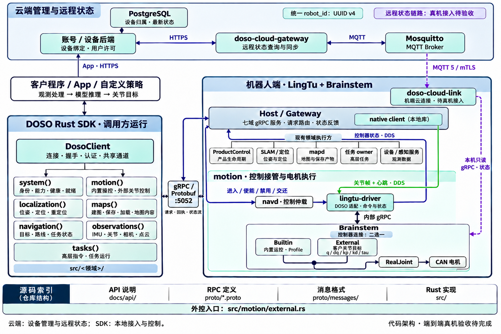
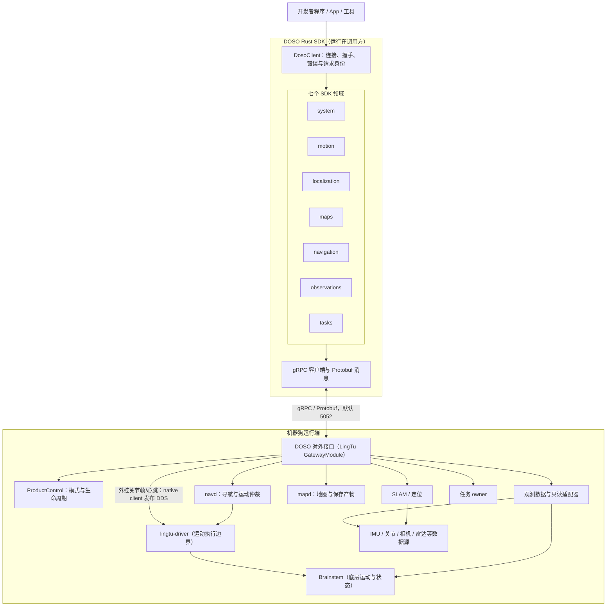
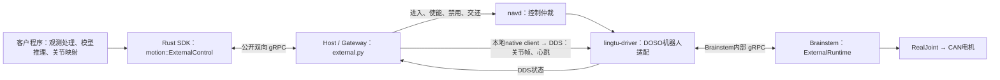

# DOSO 整机 SDK 架构

V1 主实现是异步 Rust SDK。七域通过 gRPC/Protobuf 连接 LingTu Gateway，复用现有领域操作与机器人端 owner。实现与验证范围见 [gRPC 推进记录](grpc-v1-progress.md)，产品阶段见 [V1 计划](v1-plan.md)。

云端相关内容核对日期为2026-11-08。当前云端产品状态和下一阶段由 [robot-cloud推进记录](D:/DOSO/robot-cloud/PROGRESS.md) 维护，本页说明SDK与云端的职责和连接关系。



总览图对应当前代码职责，生成及校正提示词见[图片源说明](images/doso-sdk-architecture-cloud-20261107.prompt.md)。云端虚线表示真机接入待验收，逐方法和执行文件的对应关系见下文。

## 七个领域

| 领域 | 面向开发者的职责 | 机器人端责任方 |
| --- | --- | --- |
| [system](../src/system/mod.rs) | 固件版本、机器人版本、机器人 ID、能力、模式、健康与就绪 | ProductControl、Gateway、Brainstem 状态 |
| [motion](../src/motion/mod.rs) | 站坐、电机、Profile、遥操作、外部逐关节控制、停止与身体状态 | LingTu 运动仲裁、Brainstem |
| [localization](../src/localization/mod.rs) | 位姿、坐标系、定位状态与重定位 | LingTu SLAM 和定位 |
| [maps](../src/maps/mod.rs) | 建图、地图列表、保存、加载与操作结果 | ProductControl、SLAM、mapd |
| [navigation](../src/navigation/mod.rs) | 导航目标、路径与任务生命周期 | LingTu navd |
| [observations](../src/observations/mod.rs) | IMU、关节、相机、点云等可用观测 | 对应设备或感知服务 |
| [tasks](../src/tasks/mod.rs) | 巡检、跟随、自然语言指令等高层任务 | LingTu 对应任务 owner |

表格定义领域职责，当前可调用的方法和未完成能力见 [Rust SDK](usage.md)。连接配置属于 `client`；`system` 提供系统查询。SDK 提交请求、读取状态和结果，机器人端继续管理产品生命周期、运动权限、SLAM 和规划。下图和接口描述反映代码状态，不代表已部署或完成实机验收。

## 调用链与责任归属



`GatewayModule` 管理 gRPC server 的启动与关闭。七个 service 共用一个 server 和客户端 channel，不产生七个独立进程。gRPC handler 直接调用共享操作或现有 owner，导航任务账本、停止处理、指令执行等业务规则只维护一份；旧 Web 路由也调用这些操作。

`client` 统一配置 API key metadata、HTTPS 信任根与私有 CA。机器人端 `gateway.rpc.security` 在业务处理前验证所有 RPC 的凭据，并负责读取 listener 的 TLS 配置。TLS 与 API key 分别启用，配置和接入示例由[使用说明](usage.md#api-key-与-tls)维护。

SDK 的远程入口已切换到 gRPC，ProductControl 的本机 HTTP 服务仍保留。机内已有 DDS、mapd socket 和 Brainstem gRPC 各自服务现有职责，完整链路不因 SDK 协议改变而重写。

只读适配器在 real + DOSO RunPlan 中复用现有驱动目标和证书配置，读取 Brainstem 观测与身体状态；它不转发运动命令。实机部署仍需核对目标地址、连接凭据和上游访问策略。各数据来源与缺口见[观测能力](observations.md)。

## 云端管理与本地接入

2026-11-12 明确权限：设备凭据不授予云管理权；DOSO 云端禁止远程运动控制、任意 gRPC 透传与运控隧道。本地 SDK 继续经机端控制权与安全链完成运动和导航。云状态链固定读取 `GetControlStatus`，媒体观看使用独立许可。系统 gRPC 公开查询按业务字段投影，普通客户不获得平台映射、许可版本、投递队列和内部配置；协议必需的请求身份、坐标/时间和并发切换校验不作为客户设置展示。

云端账号/设备后端管理设备归属、用户许可和最新状态，PostgreSQL保存业务数据。业务后端通过HTTPS与 `doso-cloud-gateway` 查询和同步状态；云网关经Mosquitto与机器狗上的 `doso-cloud-link` 使用MQTT 5/mTLS通信。机器狗云连接读取本机Brainstem `GetControlStatus`，来源为只读gRPC端口 `127.0.0.1:13146`。App、SDK与云端共用同一永久 `robot_id`（UUID v4）。云端工程源码位于 `D:\DOSO\robot-cloud`：`robot/`运行在机器狗，`cloud/`部署到服务器，`shared/`编译进两端，`tools/`供联调和部署使用；详情见 [robot-cloud架构](D:/DOSO/robot-cloud/ARCHITECTURE.md)。

SDK公开gRPC端口 `:5052` 继续提供本地接入。当前云端接口覆盖设备管理与远程状态；External逐关节控制不经过云网关或MQTT转发。云端Gateway自动同步已有部署记录；2026-11-07已通过正常账号、已登记模拟设备、实际Web App与真实业务数据库的状态流程，设备源为模拟Brainstem，MQTT经SSH隧道，见 [模拟流程及证据](D:/DOSO/robot-cloud/docs/SIMULATED_FLOW.md)。真实机器狗、G20、独立公网MQTT/5G及完整断云仍待验收；可信本地开启和远程持久化断云尚有实现缺口。视频为独立候选链路，部署与验收由云端项目维护。

## 代码组织与合同

```text
DOSO-SDK/
├── proto/                 doso.v1 领域协议与共享类型
├── build.rs               生成 Rust 消息与客户端
└── src/
    ├── lib.rs             模块声明与公共导出
    ├── client/mod.rs      连接、配置、元数据与回执处理
    ├── common/mod.rs      共享输入检查与请求身份
    ├── error/mod.rs       SDK 错误与 gRPC 状态转换
    └── 七个领域/          各领域方法与等待行为
```

运动和观测领域的 `mod.rs` 保留入口，具体操作按职责拆分到文件；领域职责在本页统一说明，[API手册](api/README.md)将每个领域的说明、RPC定义和Rust实现并列索引。C++ 客户端位于 `brainstem/`，历史 Python 预览位于 `archive/python/`。

`proto/` 按领域定义 service，`proto/messages/` 是消息与枚举的唯一维护位置：

```text
proto/
├── system.proto / motion.proto / localization.proto / maps.proto
├── navigation.proto / observations.proto / tasks.proto
├── common.proto / error.proto       公共消息导出入口
└── messages/                        按领域拆分的消息、枚举与错误定义
```

领域 service 通过 `import public` 引入消息；跨域共用值只定义一次。`messages/error.proto` 描述 `doso-error-bin` 尾部元数据载荷，配合 gRPC 标准错误码使用。所有文件继续使用 `package doso.v1`，原消息字段号、枚举值及 RPC 保持兼容。

Rust 构建通过 Tonic/Prost 生成类型。`scripts/generate_grpc.py` 从同一套领域协议生成 LingTu Python bindings，双方不分别维护消息模型。命令、位姿、导航任务、地图与产品操作使用明确字段；诊断快照通过 `Snapshot.fields` 的 Protobuf `Struct` 保留现有状态字段。

定位的 map 位姿来自 SLAM/定位服务，Brainstem 身体状态不作为地图位姿。地图加载和建图经过 ProductControl；加载地图定位不表示能恢复旧优化图跨会话续建。

导航 `watch` 使用服务端流；`wait` 从同一任务流等待终态。地图保存和产品切换按各自操作身份查询并等待，状态仍由对应 owner 提供。停止本地等待或超时不自动取消远端任务。

`Motion.Teleop` 使用双向流，由现有 `NativeTeleopSession` 管理仲裁与 hold/release。一次握手后，`publish_velocity()` 持续提交新速度，后台独立收取 ACK；机器人每 50ms 推送有效期固定为 350ms 的可复用窗口。序号递增、每条输入绑定原窗口，旧速度不会在发送时换新时间。SDK 队列有界，机器人和 native 发布器保留最新积压速度；停止仍等待真实回执。

`Motion.Resume` 复用HTTP与gRPC共用的恢复业务操作，保留命令journal、控制权检查与native ACK。恢复释放当前模式的hold，之后由调用者提交新目标或速度。当前运行模式来自compiled Product，完整切换归属ProductControl/RunPlan。

控制权快照来自native owner。全局 `control_state/watch_control_state` 只读，会话 `Teleop::control_state` 对照当前会话设置 `held_by_client`。源过期时 `fresh=false`，可申请与持权均保持未知。状态最高50Hz采样并可合并，源端状态和SDK缓存各自保留原职责。

`System.Faults/WatchFaults` 从 `driver.control`、`driver.health`、`navigation.control_loop` 投影当前已知故障和来源覆盖。没有已知故障时健康为Unknown，电机关闭本身属于正常状态。该投影复用现有来源，完整整机健康覆盖继续逐项接入。

`Motion.StandUp/SitDown` 复用公共 `Command/Receipt`，经过现有 journal 与 motion guard，再沿 `NavCommands.stand/sit → nav DDS → driver → Brainstem` 提交姿态请求。SDK 使用至少 15秒的请求超时等待接纳 ACK，后续身体状态由只读接口与源事件提供。SDK、Gateway 与原生姿态链已通过本地构建和合同测试，实机动作待现场验收。

`Motion.EnableMotors/DisableMotors/SwitchProfile` 复用公共命令回执，经native仲裁与driver提交Brainstem。使能和失能只管理输出门及其底层控制权限，身体动作由独立操作管理。Profile切换要求Grounded、电机关闭和控制权释放，公共操作保持调用者已准备的姿态与电机状态。`Motion.Profile`沿现有只读Brainstem端点读取current、available及说明，成功命令ACK后可独立查询确认。

`Motion.Controller/ExternalControl`提供客户自定义控制器接入，接口到执行代码的对应见下节。调用顺序、消息语义、时限和退出行为由[外部运控API](api/motion.md#自定义控制器)统一说明。

`Tasks.Watch` 由机器人端以目标 50Hz（20ms）读取并发送当前 AgentPlanner run 快照，终态或不再保留时结束。SDK 的 `Run::state()` 与单次查询共用解析，任务 owner 持有执行状态。`Localization.State` 复用现有定位状态投影，保留状态、地图、就绪、新鲜度与原因，缺少的源时间保持未设置。

## 外部运控的代码对应

控制器选择有Builtin和External两种；源不可用时返回Unknown。它与内置Profile、Product运行模式分别属于不同职责：

| 概念 | 管理的内容 | 实现入口 |
| --- | --- | --- |
| `ControllerMode` | 由内置运控还是客户程序产生关节目标 | `motion.controller/external_control`，显式close交还Builtin |
| `Profile` | 内置运控使用的策略及配置 | `motion.profile/switch_profile`，现有Brainstem执行方 |
| `Product` | SLAM、定位、导航等产品进程与运行图 | 现有ProductControl/RunPlan |

客户程序持有模型及推理过程，SDK管理连接、命令及反馈；Brainstem管理最终外控会话、内置行为隔离和电机输出。进入External后，客户提交的是逐关节q/dq/kp/kd/tau。期望机身速度可以作为客户模型输入，关节帧传输沿下面的独立DDS通道执行：



native client作为Host加载的本地库提供C ABI与DDS通信。逐帧命令保留原输入窗口，经driver转发至Brainstem；生命周期操作经过navd仲裁。只读IMU与关节观测继续走已有的 `observations` 接口。

当前三个仓库并列位于 `D:\inovxio\brain\`。下表的跨仓库源码链接按这个检出关系定位，列出的生产路径均已有实现：

| 责任 | 代码位置 | 具体实现 |
| --- | --- | --- |
| 对外RPC与消息 | [motion.proto](../proto/motion.proto)、[controller.proto](../proto/messages/controller.proto) | `Controller`查询、`ExternalControl`双向流、六种流内动作和关节字段 |
| Rust公开接口 | [motion/external.rs](../src/motion/external.rs)、[lib.rs](../src/lib.rs) | 会话、帧发布、后台回执、心跳、本地状态缓存及公共导出 |
| 机器人公开服务 | [rpc/services.py](../../lingtu/src/gateway/rpc/services.py)、[rpc/external.py](../../lingtu/src/gateway/rpc/external.py) | 两个RPC入口、请求检查、命令路由、反馈与断线清理 |
| Host命令入口 | [nav/commands/module.py](../../lingtu/src/nav/commands/module.py)、[native/commands.py](../../lingtu/src/nav/adapters/native/commands.py) | 外控命令、session及ACK关联 |
| 本地C ABI与DDS | [native/abi.py](../../lingtu/src/nav/adapters/native/abi.py)、[client_c.cpp](../../lingtu/src/nav/cpp/client/client_c.cpp)、[client.cpp](../../lingtu/src/nav/cpp/client/client.cpp) | 生命周期请求、关节/心跳DDS发布和状态读取 |
| driver执行入口 | [posture.cpp](../../lingtu/src/drivers/real/motion/posture.cpp)、[main.cpp](../../lingtu/src/drivers/real/motion/main.cpp) | 进入条件、生命周期执行、持续消费关节帧与心跳 |
| DOSO机器人适配 | [robots/doso/doso.cpp](../../lingtu/src/drivers/real/motion/robots/doso/doso.cpp) | 转发关节五字段、使能/禁用与状态 |
| 内部Brainstem客户端 | [brainstem/src/external.cpp](../brainstem/src/external.cpp) | driver持有私有token，调用后端gRPC并接收窗口和状态 |
| Brainstem内部API | [external.proto](../../brainstem/brainstem_api/brainstem_api/external.proto)、[service.dart](../../brainstem/thunder/lib/src/external/service.dart) | `RobotExternalControl`的Enter、Enable、Disable、Heartbeat、Control、Exit和GetStatus |
| 后端会话与内置隔离 | [runtime.dart](../../brainstem/thunder/lib/src/external/runtime.dart)、[cms.dart](../../brainstem/thunder_brain/lib/src/cms/cms.dart) | 唯一管理外控会话和输出期限，暂停/恢复内置行为 |
| 电机硬件入口 | [thunder.dart](../../brainstem/thunder/bin/thunder.dart)、[real_joint.dart](../../brainstem/thunder/lib/src/real_joint.dart) | 关节字段映射、现有输出门及逐电机 `RSEvent.control` |

客户部署自己的推理程序和模型；当前SDK提供控制接入，模型安装、上传和自动启动不属于已实现API。外部控制先准备整帧目标，再显式使能。实际调用方式见[逐方法对应表和示例](api/motion.md#接口与代码对应)，实现验证及现场边界见[推进记录](grpc-v1-progress.md#外部运控模式2026-11-07)。

## 返回结果的责任归属

| 位置 | 责任 |
| --- | --- |
| `proto/messages/` 与领域 RPC | 定义共享回执、错误详情和各领域消息；机器原因使用 `reason_code` |
| `src/error/mod.rs` | 统一 `code()`、`reason_code()`、`details()` 访问；持有完整 `Terminal`，保留未知提交事实 |
| `src/client/mod.rs` | 共享请求配置、连接和回执身份检查 |
| `src/navigation/mod.rs`、`src/maps/mod.rs` | 按领域状态决定继续等待或结束，失败时交出完整结果 |
| LingTu `gateway/rpc/codec.py` | 将已有 owner 结果编码为 Protobuf 或标准 gRPC 错误，转交稳定原因与原始详情 |

查询一个失败任务与等待任务成功有不同含义：查询返回已读到的状态，等待在非成功终态返回携带该状态的错误。Gateway 的兼容 `ok` 在接纳明确时从 `accepted` 投影，执行中 `success=false` 不再覆盖接纳事实；接纳字段互相矛盾时报告协议错误。

## 智身与宇树 SDK 参考

后续规划和功能推进持续以智身官方 SDK 为对照。每项功能核对调用入口、接纳与完成时序、状态和失败行为，并记录 DOSO 对应实现及明确差异；文档有冲突时标明未确认，不将推断写成厂商行为。当前以以下固定提交作为可复查基准，DOSO 保持已选定的 Rust/gRPC 与七领域组织。

参考智身官方 `genisom_robot_sdk` 的固定提交 `e8f959a22a6e5714bc299a551b45e1c182ac05c7`：[类型说明](https://github.com/zsibot/genisom_robot_sdk/blob/e8f959a22a6e5714bc299a551b45e1c182ac05c7/docs/zh/sdk_type_zh.md)将命令参数、应答 ACK、持续上报数据分开，[回调说明](https://github.com/zsibot/genisom_robot_sdk/blob/e8f959a22a6e5714bc299a551b45e1c182ac05c7/docs/zh/sdk_callback_zh.md)分别定义控制应答和数据回调。

该 SDK 使用 JSON 与 UDP/WebSocket，没有可直接沿用的 Protobuf 合同。DOSO 借鉴其命令、应答、上报的区分与业务职责划分；本项目的通信仍采用 gRPC/Protobuf，并按自己的七域维护合同。命令已发送、请求被接纳和任务已完成继续分别表达。

### 连接与操控对照

智身采用上述固定提交，宇树采用官方 `unitree_sdk2` 固定提交 `8e1b927586712edd6a4c29d50dd52dff1e163439` 的 Go2 `SportClient`。表中核对公开头文件、连接示例及协议说明。DOSO一栏表示当前代码接线，实机动作仍需验收。

| 能力 | 智身 GEN2 | 宇树 Go2 SDK2 | DOSO Rust SDK |
| --- | --- | --- | --- |
| 建立连接 | `SDKClient::Connect(ip, port, ...)`，传输连接后完成应用握手 | `ChannelFactory::Init(domain, networkInterface)`、`SportClient::Init()`，DDS请求/响应 | `DosoClient::connect/with_config`，gRPC通道与应用握手，支持API key/TLS |
| 控制权 | `TakeControl/ReleaseControl`，配套ACK、失权与可申请事件 | `SportClient(enableLease=false)`，基类支持可选lease等待与查询 | `claim_control`开同一Teleop会话，`claim`单次申请/重新申请，`release_control`复用close；native lease为1秒，权限提供最高50Hz快照，完整逐次事件尚无合同 |
| 站起与降低身体 | `StandUp/BalanceStandUp/LieDown` | `StandUp/StandDown`，另有独立`Sit/RiseSit` | `stand_up/sit_down`已接nav仲裁和driver；当前动作对应Brainstem StandUp/SitDown，具体姿态按DOSO实机验收 |
| 平面速度 | `MoveVelocity(x,y,yaw)`使用m/s、rad/s；`Move`使用归一化输入 | `Move(vx,vy,vyaw)` | `teleop().publish_velocity`持续提交机体XY线速度与Z角速度，`send_velocity`可等待接纳回执；本地50Hz已验证 |
| 停止与软件急停 | 普通停止示例发送零控制量，`SoftEmergencyStop(bool)`独立控制急停 | `StopMove()`，另有`Damp()`动作 | `stop/hold/close`以及`emergency_stop/clear_emergency_stop`已接线；停止回执与身体反馈分别核查 |
| 身体姿态与高度 | `PosControl/PosMove`提供位置与RPY，`HighLowStance`提供高低站姿 | 当前头文件公开`Euler`；本固定版示例中的`BodyHeight`仅为注释 | Euler、站高的机器人端执行能力与Rust接口待接入 |
| 步态与恢复 | `Gait()`为无步态类型参数的方法，`SetSpeed()`设置速度等级 | `SpeedLevel/StaticWalk/TrotRun/EconomicGait/FreeWalk`及`RecoveryStand/Damp` | 具体步态、恢复与阻尼需先接执行方；DOSO driver声明stand/sit可用，recover/damp返回unsupported，Brainstem速度档位RPC当前UNIMPLEMENTED |

智身接口与控制权语义分别依据官方API说明和控制权说明。[智身API](https://github.com/zsibot/genisom_robot_sdk/blob/e8f959a22a6e5714bc299a551b45e1c182ac05c7/docs/zh/sdk_client_api_zh.md) · [智身控制权](https://github.com/zsibot/genisom_robot_sdk/blob/e8f959a22a6e5714bc299a551b45e1c182ac05c7/docs/zh/sdk_control_ownership_zh.md)

宇树方法依据Go2公开头文件，网卡与DDS初始化依据官方示例。H1、G1客户端应按各自型号核对。[Go2公开接口](https://github.com/unitreerobotics/unitree_sdk2/blob/8e1b927586712edd6a4c29d50dd52dff1e163439/include/unitree/robot/go2/sport/sport_client.hpp) · [Go2连接与操控示例](https://github.com/unitreerobotics/unitree_sdk2/blob/8e1b927586712edd6a4c29d50dd52dff1e163439/example/go2/go2_sport_client.cpp)

DOSO导航目标、任务暂停/恢复/取消由`navigation`维护，地图建图/保存/加载由`maps`维护，巡检/跟随统一入口继续按其实际owner能力补齐。完整可调用方法由API手册维护，缺口推进顺序由V1计划维护。[API手册](api/README.md) · [能力缺口](v1-plan.md#对标后的能力缺口)

## 当前边界

调用结果、命令接纳和领域执行状态的定义及现有实现差距见 [返回码与状态](results.md)。

`DosoClient::connect(...).await` 完成通道建立和只读协议握手。`system().info()` 借用同一份初次握手快照，对外提供固件版本、机器人版本和机器人 ID。固件版本读取运行发布包的元数据，Gateway 与 Web bootstrap 共用型号选择函数，缺失项保留未设置。动态环境、会话和就绪状态由各自查询提供，来源与发布规则见[机器人信息与固件发布](release.md)。

对齐智身的“传输连接 + 应用握手”时序，DOSO默认连接采用观察行为，智身协议的`observe_only`默认false。DOSO的Teleop控制权申请、重新申请与释放归属同一会话。该native lease为1秒，Teleop没有后台保活。全局只读快照保持 `held_by_client` 未设置，会话快照才表达本会话持权。最高50Hz快照可合并，完整逐次事件和重连后的控制会话恢复仍待接入。

| 领域 | 已有 SDK 能力（代码层面） | 主要缺口 |
| --- | --- | --- |
| `system` | 身份、健康与就绪查询；类型化综合状态、就绪、已知故障与来源覆盖快照 | 更完整的整机健康覆盖待接入；电池/BMS真实来源待确认 |
| `motion` | 站起/坐下、电机使能/失能、profile查询/切换、外部逐关节控制、停止、急停/复位、显式恢复、会话控制权管理、权限快照、身体状态与事件、底层控制查询、SLAM速度/里程计、受控遥操作 | 里程计与默认速度源约10Hz；完整权限事件、Product运行模式公共接线、姿态/步态后端与现场运动验收待推进 |
| `localization` | 位姿查询与流、接收年龄/新鲜度、类型化定位状态、WGS84 地理位置查询/1Hz流、重定位 | GNSS 保留源时间及无 fix/过期状态；真实 GNSS 与实机定位链待验收 |
| `maps` | 地图列表、保存/加载、PCD 读取、保存栅格读取 | 真实地图、存取和设备内存表现待验收；实时栅格未提供 SDK 接口 |
| `navigation` | 目标、任务状态/暂停/恢复/取消、路线查询与流 | 真实导航闭环待验收；路线缓存高度的兼容默认值需明确来源 |
| `observations` | IMU、关节、相机、实时预览点云流；电机查询 | 数据源时间、关节映射、相机元信息和频率实测待完善；足端、光照数据源待确认 |
| `tasks` | 指令、当前运行查询与取消、类型化运行状态、当前 run 50Hz 快照流 | 统一巡检/跟随任务及历史运行查询待完善 |

跨领域已接通 gRPC API key 鉴权与 TLS，默认未配置凭据或证书时采用开发用明文 listener。生产凭据、证书配置、断线恢复、SDK 版本兼容与实机端到端验证继续推进。运动、位姿和路线快照目标最高 100Hz，实际频率受源更新、处理与网络影响。导航和高层任务采用目标 50Hz 周期快照；遥操作发布与应答独立，输入绑定有效期固定为 350ms 的机器人窗口。

本地客户端与 handler 验证、真实服务接线、仿真闭环和实机验收分别记录。请求接纳、动作完成和物理停稳分别表达，不能从协议或语言选型推导出运动安全与硬实时结论。

当前 Brainstem 在缺少 walking lease 的 Grounded/Transitioning 状态下，底层 stop 可能返回 `lease_missing`。姿态请求 ACK 记录接纳，动作到位和物理停稳仍需后续身体状态与现场验证。

公共Profile切换和内部自动切换共用执行方规则。Brainstem硬件服务要求Grounded、电机关闭和释放控制，内部自动切换由driver状态机管理准备及恢复电机阶段，仅恢复入口明确已使能且由本次流程关闭的输出门，入口已关闭时保持关闭。Recovery仍需接入独立会话与心跳生命周期，height、gait、damp需先补机器人端执行能力。各接口的设备动作与故障恢复继续现场验收。
